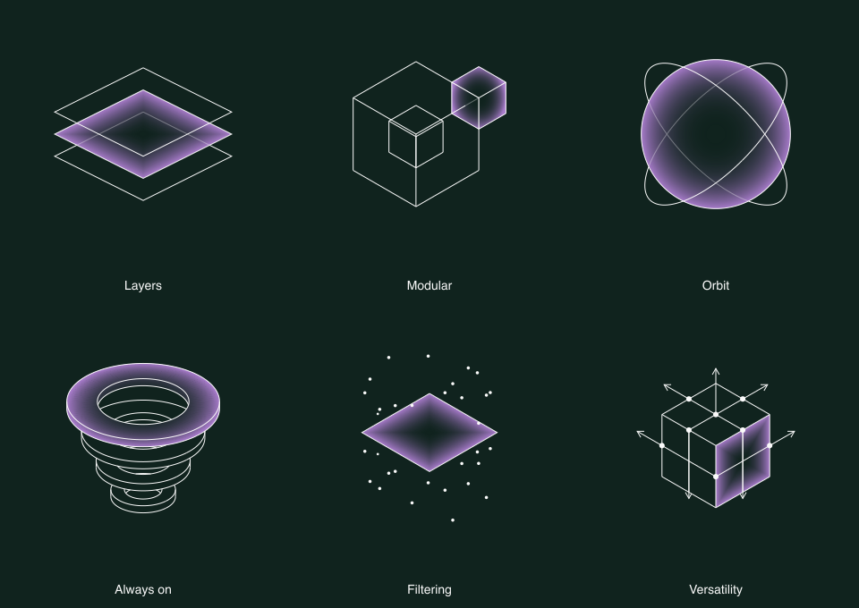

# AtomsAI illustration creation

Build one clear idea from complete, dimensioned geometry. Match the current gallery's visual language and keep the object coherent when rotated. Use the supplied renderer; spend design effort on the scene, not on recreating gradients, camera math or hidden-line rendering.

## Choose the right source

1. The user's current request and local guidelines take priority.
2. The **current rendered gallery and scene source** define approved appearance. The original SVG files are historical composition/framing inputs: some still have old colors, radial fills on rectangles, or linework that was deliberately removed. Do not use them as pixel-perfect acceptance targets or as current production exports.
3. Without the repository, use this kit's renderer and visual references, generated together from the gallery. [Reference manifest](assets/reference-manifest.json) records exact source hashes, palette and active gallery slugs. It distinguishes the visible gallery from retained construction code.

Inspect the [dark references](assets/neutral-dark.png), [light references](assets/neutral-light.png) and [rotated references](assets/rotated-dark.png) before constructing a new example. Pick the closest construction family, then compare at the same viewport size.



| Closest example | Use it to understand |
| --- | --- |
| Layers / Stack / States | Equal sheets, regular spacing, one diamond fade, shared depth |
| Modular / Nested / Versatility | Complete cubes, intentional structural edges, one selected solid or face |
| Orbit / Input | Actual spheres and circular hoops, apparent contours that change with rotation |
| Always on | Hollow cylinders, genuine openings, opaque hidden-line removal |
| Unfolding | Equal pages, common hinge, geometric symmetry |
| Filtering / Precision | Sparse points or purposeful rays in a specified plane or volume |

## Start a new illustration

**Prerequisite:** Node.js 22 or newer. SVG creation needs no installed packages or network. PNG output uses `sharp` when available; in the repository, existing dependencies supply it. Use the complete [skill kit](https://petrknoll95.github.io/atoms-ai-brand/skills/atomsai-skills.zip), not just the Markdown file, for the runnable resources.

Copy [the sheet recipe](recipes/planes.mjs) or [the hollow-cylinder recipe](recipes/rings.mjs) into a scratch directory. A recipe exports `title`, `reference`, a default function returning raw `Scene` geometry, and optionally `verify(scene, api, assert)` for concept-specific checks. `reference` chooses an existing example's framing, **not its geometry**. The runner applies that fit once; do not normalize the scene yourself.

From the extracted `atomsai-illustrations` directory:

```sh
node scripts/render.mjs --recipe /absolute/path/my-scene.mjs --out /absolute/path/review
```

Inside the source repository, add `--repo /absolute/path/atoms-ai-brand`. This verifies the kit against current local sources and enables the installed PNG dependency. If stale, run `node scripts/build-illustration-skill.mjs` in the repository before retrying. Do not silently use an older bundled renderer over current local changes.

The runner exports eight views: neutral, oblique, back and underside, each on Dark and Light; transparent SVGs; PNGs when available; a contact sheet beside the chosen gallery reference; `review.html`; and a mechanical check report. Open the contact sheet to judge appearance. A passing report is **not** a visual approval. To export an existing current example, use `--existing layers` instead of `--recipe`.

Read [construction and API notes](references/construction.md) for primitives, surfaces, highlights and physical relationships. Read [gallery integration](references/integration.md) only when adding or changing an interactive site example. Export-only work does not need gallery UI or performance testing.

## Visual contract

| Element | Rule |
| --- | --- |
| Composition | One concept; one focal highlighted part; centered, generous clear space. Preserve deliberate existing exceptions such as Stack 2's two end layers. |
| Surfaces | Dark: Forest shade `#10231E`, with Paper `#FAFAFA` linework. Light reverses these. Dark is the default. Resolve tokens from current palette. |
| Accent | Iris `#A77BCA` only in illustrations. No extra vivid accent or Orange family. |
| Linework | One thin width, miter joins, butt caps. Visible edges and highlighted outlines at 100%. Structural edges only, no mesh tessellation or duplicate line passes. |
| Hidden edges | One 35% opacity group, independent of how many surfaces cover a line. Color fills and visibility are separate operations. |
| Opaque objects | When requested, set `hiddenLines = 'omit'`: hidden segments and nodes disappear. Always on and Versatility already use this mode. Culled rear edges must reappear when their surfaces turn toward the viewer. |
| Rectangular highlight | Diamond fade aligned to all four edges. Center opacity 0; midpoint 25%; boundary 100% (`t²`). |
| Curved highlight | Shared radial fade: center 0; midpoint 12.5%; boundary 100% (`t³`). Highlighted solids use one projected silhouette, not a gradient restarted on every face. |
| Gradient boundary | Clip to the intended part and preserve real holes. No outer glow, pale halo, background-colored fill or lighting effect. A transparent center is intentional. |
| Camera and fit | Shared orthographic camera, yaw 45°, pitch 30°; neutral user rotation `(0, 0)`. Poses belong to the model. Use the runner's reference fit and the existing gallery settings. |
| Output | 384 × 384 padded viewport. Stroke 1.28 units, appearing as 1 px at 300 px viewport. Geometry fits reference framing; rotation may use up to ±170 units, retaining at least 22 units of outer padding. Do not rescale individual axes. |

For a single highlighted face on an opaque solid, give the highlight its outward `normal`; its fill must disappear when viewed from behind. A rim-only highlight is an annulus with a real hole, not a highlight on the entire tube. Use the supplied ring recipe for that distinction.

Build actual boxes, planes, spheres/ellipsoids, hemispheres, hollow cylinders, circular hoops and connecting curves. Keep positive Y up. Use shared vertices, dimensions, axes and attachment points. Symmetry should be generated by reflection or equal angle increments, not hand-adjusted screen coordinates. Do not trace a front view and assign arbitrary depth, or substitute camera-facing ellipses for cylinders and spheres.

## Verify the result

1. **Judge the neutral design beside its nearest current reference.** Compare scale, clear space, density, thin strokes and highlight character. The concept can differ; the visual system should not. Inspect both Dark and Light at the intended display size as well as enlarged.
2. **Inspect all four generated orientations.** Check complete solids, circles remaining circular in world space, consistent gaps, intended symmetry, connected endpoints and open holes. Check front/side views too when they expose a relevant relationship. A pleasing neutral view does not excuse broken depth.
3. **Inspect the actual exported files.** No duplicate strokes, exposed mesh edges, overshooting connectors, extra rays, halo or seams across holes. Opaque examples have no hidden-line group contents; translucent examples have one shared 35% pass. The SVG must be self-contained vectors; PNGs must be rasterized from the same SVG.
4. **Use concept-specific assertions.** For example, test common hinge/size and reflection for a book, a real hole and wall thickness for a tube, or nonzero depth spread for a cloud. Do not substitute file-name checks for geometry tests.
5. **Keep failures visible.** If a defect comes from the shared renderer, preserve a reproducible angle and proof. Fix the source once and regenerate the kit, or report the limitation. Do not patch exports, hide a bad angle, add strokes or alter local opacity to make one image pass.

Only gallery integration needs live p5 checks: rotation/reset, responsive Dark/Light previews, canvas/export parity and interaction timings. Follow the linked integration notes. Report what was actually tested; CPU projection timings do not prove interactive frame rate.

## Placement and delivery

One lead illustration per slide, hero or editorial layout. In feature grids use up to three, one per card. Leave clear space at least one eighth of the artwork width; copy stays outside it.

Simple artwork starts at 200 px artwork-frame width; dense concepts at 280 px. These are **artwork-frame** sizes, distinct from the padded 384-unit export viewport. Scale artwork and strokes together; check final strokes at least 1 px and visible gaps at least 2 px. Use an [icon](https://petrknoll95.github.io/atoms-ai-brand/skills/atomsai-icons/SKILL.md) for smaller placements.

Deliver the editable recipe and current SVGs, with PNGs if requested, or the integrated preview. Exports are transparent: the selected theme chooses contrasting ink, not a baked background. Use unique IDs when embedding several SVGs inline. Test artifacts stay outside the gallery unless the user asks to add them. Do not push or deploy without authorization.
